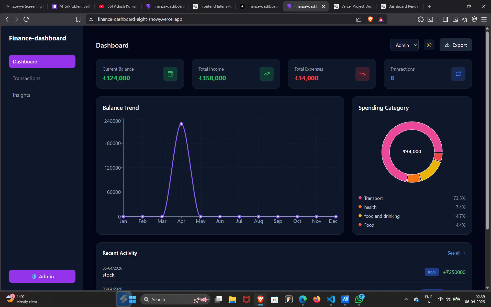
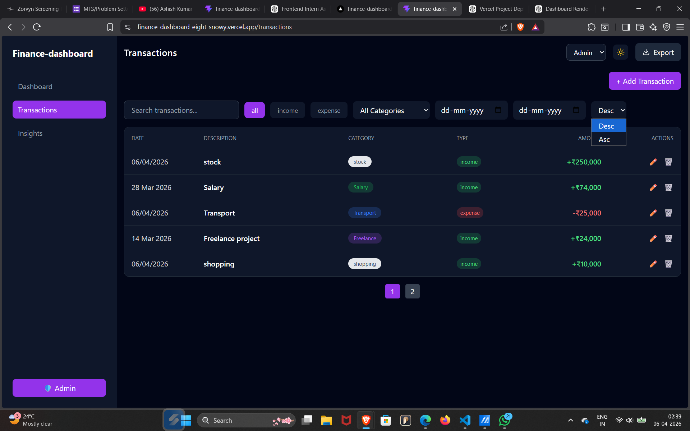
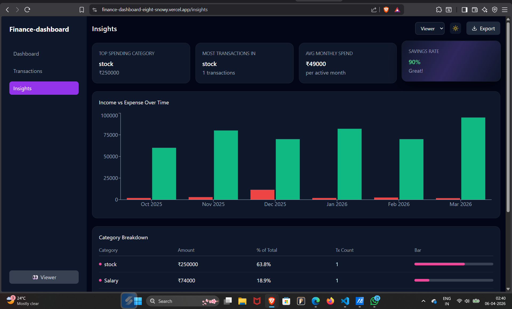

# 💎 FinanceFlow — Executive Wealth & Cashflow Intelligence OS

[](https://react.dev/)
[](https://vitejs.dev/)
[](https://tailwindcss.com/)
[](https://recharts.org/)
[](https://www.framer.com/motion/)
[](#)
[](LICENSE)

> A modern, production-grade FinTech dashboard designed for executive cash flow tracking, transaction management, and heuristic financial intelligence. Built with **React 19, Vite, Tailwind CSS, Recharts, and Framer Motion**.

---

## 🌐 Links & Resources

- **Live URL:** [https://finance-dashboard-eight-snowy.vercel.app/](https://finance-dashboard-eight-snowy.vercel.app/)
- **GitHub Repository:** [https://github.com/vinay7376/finance-dashboard](https://github.com/vinay7376/finance-dashboard)

---

## 📸 Application Preview

| 📊 Overview Dashboard | 🧾 Transaction Ledger |
| :---: | :---: |
|  |  |

<p align="center">
  <b>🧠 Financial Insights & Analytics</b><br/>
  
</p>

---

## ⚡ Key Engineering & Architecture Highlights

### 1. 📊 Executive Dashboard
- **4 Key Financial Metrics:** Real-time tracking of Current Balance, Total Income, Total Expenses, and Transaction count with visual trend indicators.
- **Cash Flow Balance Trend Line Chart:** Interactive Recharts dynamic LineChart with responsive month-based parsing and neon purple gradient accents (`#8b5cf6`).
- **Spending Category Donut Breakdown:** Interactive Donut chart displaying proportion of expenditures by category with centered total sum and color-coded legend tags.
- **Recent Activity Ledger:** Live transaction stream with category badges, date timestamps, and amounts formatted with visual color cues.

### 2. 🧾 Enterprise Transaction Management
- **Instant Search:** Multi-attribute filtering across description, notes, and category tags.
- **Type Filtering & Categories:** Filter dynamically between All, Income, and Expense, alongside category drop-down filters.
- **Full Non-Destructive CRUD:**
  - **Add Transaction:** Interactive modal with automatic type toggles, validation, and date picker.
  - **Edit Transaction:** Inline pencil action updating existing records in-place without data duplication.
  - **Delete Transaction:** Protected deletion flow backed by confirmation dialogs.
  - **CSV Export:** One-click instant CSV ledger export.

### 3. 🧠 Financial Insights & Analytics
- **Dynamic Aggregations:** 100% computed from transaction history — Top Spending Category, Most Frequent Activity, Average Monthly Spend, and Net Savings Rate.
- **Income vs Expense Over Time:** Side-by-side grouped BarChart highlighting monthly cash inflows vs outflows.
- **Category Breakdown Matrix:** Proportional ranking table with custom styled percentage indicators and visual progress meters.

### 4. 🛡️ Role-Based Access Simulation (RBAC)
- **Admin Role:** Full permissions to Add, Edit, Delete, and Export transactions.
- **Viewer Role:** Safe read-only mode with disabled mutations for demonstration purposes.

---

## 🛠️ Tech Stack & Tooling

| Domain | Technology |
|---|---|
| **Framework & Runtime** | React 19, Vite 8 (Rolldown / ESM) |
| **Styling & Design System** | Tailwind CSS 3.4, PostCSS, Lucide React Icons |
| **Data Visualization** | Recharts 3.8 (LineCharts, BarCharts, Pie/Donut Charts) |
| **Micro-Animations** | Framer Motion 12 |
| **Routing & Navigation** | React Router DOM 7 |
| **State & Persistence** | React Context API, Custom Hooks, LocalStorage |
| **Code Quality** | ESLint 9 (Strict Rules), Prettier |

---

## 📁 Architecture & File Structure

```text
src/
├── components/
│   ├── common/
│   │   ├── ConfirmModal.jsx       # Reusable confirmation dialog
│   │   └── Toast.jsx              # Floating notification toast
│   ├── dashboard/
│   │   ├── CategoryChart.jsx      # Interactive donut expense breakdown
│   │   ├── MetricCards.jsx        # 4 live balance, income & expense cards
│   │   ├── RecentTransactions.jsx # Latest activity stream
│   │   └── TrendChart.jsx         # Balance Trend line chart
│   ├── insights/
│   │   └── InsightCards.jsx       # Savings rate, top category & average spend cards
│   ├── layout/
│   │   ├── Sidebar.jsx            # Collapsible responsive sidebar with RBAC indicator
│   │   └── Topbar.jsx             # Role switcher, CSV export & theme toggle
│   └── transactions/
│       ├── Filters.jsx            # Search, category, date & sort filter bar
│       ├── TransactionModal.jsx   # Add/Edit modal with validation
│       └── TransactionTable.jsx   # Responsive transaction data grid with Edit/Delete
├── data/
│   └── defaultData.js             # Seed transactions & categories
├── hooks/
│   └── useFinance.jsx             # Global finance context, CRUD, RBAC, analytics
├── pages/
│   ├── Dashboard.jsx              # Overview analytics page
│   ├── Insights.jsx               # Deep intelligence & category breakdown page
│   └── Transactions.jsx           # Full ledger management page
├── utils/
│   └── formatters.js              # Currency, date formatting & CSV export
├── App.jsx
├── main.jsx
└── index.css                      # Typography & dark theme tokens
```

---

## 🚀 Local Development Setup

1. **Clone the repository:**
   ```bash
   git clone https://github.com/vinay7376/finance-dashboard.git
   cd finance-dashboard
   ```

2. **Install dependencies:**
   ```bash
   npm install
   ```

3. **Start the local dev server:**
   ```bash
   npm run dev
   ```

4. **Verify production build & linting:**
   ```bash
   npm run lint
   npm run build
   ```

---

## 👨‍💻 Author

**Vinay Pal**  
- **GitHub:** [@vinay7376](https://github.com/vinay7376)  
- **Role:** Frontend Developer / Full Stack Software Engineer  

---

## 📄 License

This project is licensed under the [MIT License](LICENSE).